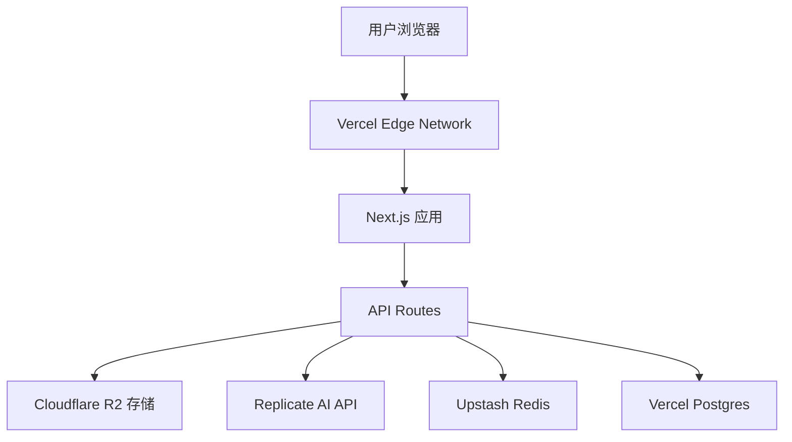

# AI Photo Editor 设计文档

## 概述

AI Photo Editor是一个现代化的Web应用程序，采用前后端分离架构，集成先进的AI图像处理技术。系统设计重点关注用户体验、性能优化和可扩展性，为用户提供专业级的在线照片编辑服务。

## 架构设计

### 整体架构



### 技术栈选择

**前端技术栈:**
- React 18 + TypeScript - 现代化UI开发
- Next.js 14 - 服务端渲染和性能优化
- shadcn/ui - 高质量可复用组件库
- Tailwind CSS - 快速响应式样式开发
- Zustand - 轻量级状态管理
- React Query - 数据获取和缓存

**后端技术栈:**
- Next.js API Routes - 简化的API服务
- Vercel/Cloudflare Workers - 无服务器部署
- Cloudflare R2 - 文件存储
- Upstash Redis - 缓存和任务队列
- Vercel Postgres/Neon - 轻量级数据库

**AI技术栈:**
- Replicate API - 托管的AI模型服务
- TensorFlow.js - 客户端轻量级处理
- Canvas API - 图像预处理和滤镜
- 预训练模型: Real-ESRGAN, GFPGAN (通过Replicate)

## 组件和接口设计

### 前端组件架构

```
src/
├── components/
│   ├── common/           # 通用组件
│   │   ├── Button/
│   │   ├── Modal/
│   │   └── ProgressBar/
│   ├── editor/           # 编辑器组件
│   │   ├── PhotoCanvas/  # 照片显示画布
│   │   ├── ToolPanel/    # 工具面板
│   │   ├── ParameterSlider/ # 参数调节器
│   │   └── HistoryPanel/ # 历史记录面板
│   └── upload/           # 上传组件
│       ├── DropZone/
│       └── FilePreview/
├── hooks/                # 自定义Hooks
├── services/             # API服务
├── stores/               # 状态管理
└── utils/                # 工具函数
```

### 核心组件设计

#### PhotoCanvas组件
```typescript
interface PhotoCanvasProps {
  imageUrl: string;
  filters: FilterSettings;
  onImageLoad: (dimensions: ImageDimensions) => void;
  onParameterChange: (params: EditParameters) => void;
}

interface FilterSettings {
  brightness: number;
  contrast: number;
  saturation: number;
  sharpness: number;
  temperature: number;
}
```

#### AIEnhancementService
```typescript
interface AIEnhancementService {
  enhancePhoto(
    imageFile: File, 
    mode: EnhancementMode
  ): Promise<EnhancementResult>;
  
  getAvailableModes(): EnhancementMode[];
  
  getProcessingStatus(taskId: string): Promise<ProcessingStatus>;
}

enum EnhancementMode {
  PORTRAIT = 'portrait',
  LANDSCAPE = 'landscape',
  NIGHT = 'night',
  BLACK_WHITE = 'black_white',
  ARTISTIC = 'artistic'
}
```

### API接口设计

#### 照片上传接口
```
POST /api/photos/upload
Content-Type: multipart/form-data

Request:
- file: 照片文件
- options: { autoEnhance: boolean, mode?: string }

Response:
{
  "photoId": "uuid",
  "originalUrl": "https://r2.cloudflare.com/bucket/original/...",
  "thumbnailUrl": "https://r2.cloudflare.com/bucket/thumbnails/...",
  "metadata": {
    "width": number,
    "height": number,
    "format": string,
    "size": number
  }
}
```

#### AI增强接口
```
POST /api/photos/{photoId}/enhance
{
  "mode": "portrait|landscape|night|black_white|artistic",
  "intensity": 0.1-1.0
}

Response:
{
  "taskId": "uuid",
  "status": "queued|processing|completed|failed",
  "estimatedTime": number,
  "resultUrl": "string" // 完成后提供
}
```

#### 参数调整接口
```
POST /api/photos/{photoId}/adjust
{
  "parameters": {
    "brightness": -100 to 100,
    "contrast": -100 to 100,
    "saturation": -100 to 100,
    "sharpness": -100 to 100,
    "temperature": -100 to 100
  }
}

Response:
{
  "adjustedUrl": "string",
  "previewUrl": "string"
}
```

## 数据模型

### 用户会话模型
```sql
CREATE TABLE edit_sessions (
  id UUID PRIMARY KEY,
  user_id VARCHAR(255),
  original_photo_url VARCHAR(500),
  current_photo_url VARCHAR(500),
  edit_history JSONB,
  created_at TIMESTAMP,
  updated_at TIMESTAMP,
  expires_at TIMESTAMP
);
```

### 处理任务模型
```sql
CREATE TABLE processing_tasks (
  id UUID PRIMARY KEY,
  session_id UUID REFERENCES edit_sessions(id),
  task_type VARCHAR(50), -- 'ai_enhance', 'parameter_adjust'
  status VARCHAR(20), -- 'queued', 'processing', 'completed', 'failed'
  parameters JSONB,
  result_url VARCHAR(500),
  error_message TEXT,
  created_at TIMESTAMP,
  completed_at TIMESTAMP
);
```

### 前端状态模型
```typescript
interface EditorState {
  currentPhoto: {
    id: string;
    originalUrl: string;
    currentUrl: string;
    metadata: PhotoMetadata;
  };
  editHistory: EditStep[];
  currentParameters: FilterSettings;
  processingTasks: ProcessingTask[];
  ui: {
    isLoading: boolean;
    activePanel: 'enhance' | 'adjust' | 'export';
    showHistory: boolean;
  };
}
```

## 错误处理

### 错误分类和处理策略

1. **上传错误**
   - 文件格式不支持: 显示支持格式列表
   - 文件过大: 提供压缩建议
   - 网络错误: 自动重试机制

2. **处理错误**
   - AI服务不可用: 降级到基础滤镜
   - 处理超时: 提供取消和重试选项
   - 内存不足: 自动调整处理参数

3. **导出错误**
   - 格式转换失败: 提供替代格式
   - 存储空间不足: 清理临时文件

### 错误恢复机制
```typescript
interface ErrorRecoveryService {
  handleUploadError(error: UploadError): RecoveryAction;
  handleProcessingError(error: ProcessingError): RecoveryAction;
  handleExportError(error: ExportError): RecoveryAction;
}

interface RecoveryAction {
  type: 'retry' | 'fallback' | 'manual';
  message: string;
  action?: () => Promise<void>;
}
```

## 测试策略

### 单元测试
- 组件渲染测试
- 工具函数测试
- API服务测试
- 状态管理测试

### 集成测试
- 上传流程端到端测试
- AI增强流程测试
- 参数调整实时预览测试
- 导出功能测试

### 性能测试
- 大文件上传性能
- AI处理响应时间
- 并发用户负载测试
- 内存使用监控

### 用户体验测试
- 不同设备响应式测试
- 网络条件适应性测试
- 无障碍访问测试
- 浏览器兼容性测试

## 性能优化策略

### 前端优化
1. **图像优化**
   - WebP格式优先
   - 渐进式加载
   - 缩略图预览
   - 懒加载实现

2. **代码优化**
   - 代码分割和懒加载
   - Tree shaking
   - 组件级缓存
   - Service Worker缓存

### 后端优化
1. **处理优化**
   - 异步任务队列
   - 批量处理
   - 结果缓存
   - CDN分发

2. **资源管理**
   - 连接池管理
   - 内存使用监控
   - 自动扩缩容
   - 负载均衡

## 安全考虑

### 数据安全
- 文件上传验证和扫描
- 临时文件自动清理
- 用户数据加密存储
- API访问频率限制

### 隐私保护
- 照片自动过期删除
- 不存储用户个人信息
- 处理过程数据脱敏
- 符合GDPR等隐私法规

## 部署和运维

### 部署架构
- Vercel 自动化部署
- Cloudflare R2 全球CDN分发
- 环境变量管理
- Git集成的CI/CD

### 监控和日志
- Vercel Analytics
- Sentry 错误追踪
- Cloudflare Analytics
- Upstash Redis监控